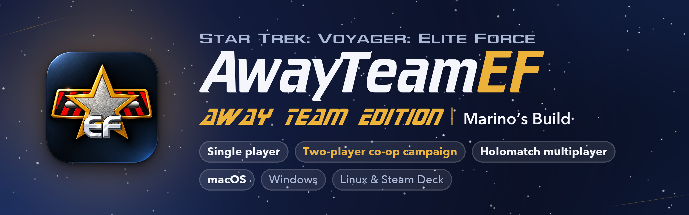

# AwayTeamEF: Marino's Build

**Play *Star Trek: Voyager: Elite Force* again, and play the campaign with a friend.**

My family didn't let me play M-rated games like Quake growing up, so I played Elite Force as a kid!
With this project, I wanted to make an easy way to play it again, especially at LAN parties.

**[⬇ Download the latest release](https://github.com/marinohardin/AwayTeamEF/releases/latest)**
for macOS (Apple Silicon), Windows or Linux & Steam Deck. You need your own copy of the game.

## What This Is

A modern, native version of *Star Trek: Voyager: Elite Force* (Raven Software, 2000) with
the **single-player campaign**, **two-player co-op** and **Holomatch** multiplayer in one app.

A launcher lets you pick **Single Player** or **Holomatch**, set up the graphics and find your
game files, then starts the game. It runs on an ioquake3-based engine with a Vulkan renderer
(see [Credits](#credits-and-license)).

It can also run a **dedicated multiplayer server**, with automatic router port opening and a
check that the server is listed on the internet, which makes hosting far simpler than in the
original game.

**No game data is included.** You need your own copy of the retail game. (Even the icon
intentionally avoids copyrighted symbols.)

## New: The Campaign in Two-Player Co-op

**Play the whole single-player story with a friend.** One of you hosts the campaign as usual;
the other joins as a second Hazard Team member, on the same network or over the internet.

- **Click Co-op… in the launcher**, then **Host** or pick your friend's game from the list.
- **Downed, not dead.** Run out of health and your partner has about 30 seconds to revive you by holding Use.
- **Saves work as before.** The host saves; player 2's health and weapons come back with the save.
- **Pick your look.** Play player 2 as male or female Munro, a Voyager crew member, or one of 24
  Holomatch characters like Gowron and Captain Proton.
- **Mix computers.** Mac, Windows and Linux all have co-op and use the same protocol.

Co-op is new, so expect the odd glitch. See the [co-op guide](docs/GUIDE.md#co-op) for the
details and its known limits.

## Screenshots

## Get Started

**1. Get the game.** Any PC copy works: GOG, Steam, or the CD with patch 1.2. The game must
include `pak0.pk3`, `pak1.pk3` and `pak2.pk3`. With GOG, you can simply choose the setup `.exe` you
downloaded, no PC needed. The Expansion Pack is optional.

**2. Download AwayTeamEF** from the [Releases page](https://github.com/marinohardin/AwayTeamEF/releases/latest):

| | Download | Needs |
|---|---|---|
| **macOS** (most tested) | `.dmg` — drag the app to Applications | Apple Silicon (M1 or later), macOS 12+ |
| **Windows** | `-setup.exe` installer, or the `.zip` | Windows 10 or 11, 64-bit |
| **Linux & Steam Deck** | `.AppImage` — make it executable and open it | glibc 2.31+ (Ubuntu 20.04 or later), SteamOS |

Windows and Linux need a graphics driver with Vulkan 1.1. The Windows build isn't code-signed yet:
if Windows says "Windows protected your PC", click **More info**, then **Run anyway**.

**3. Open it and choose your game files.** The launcher looks for them, or click **Choose…**
and pick the folder with `BaseEF` in it (or GOG's setup `.exe`). Then pick **Single Player**,
**Co-op…** or **Holomatch** and click **Play**.

Steps for each platform, Steam Deck setup, and where saves live:
**[the player's guide](docs/GUIDE.md)**.

## Features

- **The full campaign**, with Bink cinematics, skippable cutscenes and **original PC saves**.
- **Two-player co-op** for the whole campaign. See [above](#new-the-campaign-in-two-player-co-op).
- **Holomatch online and at LAN parties**, playable with the original game (version 1.2), with
  [cMod](https://github.com/Chomenor/ioef-cmod)'s fixes, widescreen HUD and lag compensation.
- **A server browser** with player lists, map previews, favorites and `stvef://` join links.
- **One-click server hosting** with a status window and automatic router port opening.
- **Modern graphics:** widescreen, Retina / high resolution, full screen, Vulkan, and quality presets.
- **Automatic update checks** so you know when a new version is out.

## Learn More

- [Player's guide](docs/GUIDE.md): game files, co-op, Holomatch and LAN parties, hosting a
  server, master servers, Windows and Linux.
- [Building from source](docs/BUILDING.md) and [technical notes](docs/macos-port-notes.md).
- [Contributing](CONTRIBUTING.md).

## Known Issues

- **The Mac is the most tested platform.** Windows and Linux have had less testing on real PCs.
- **Co-op is new.** It has mostly been tested with two copies on one Mac. Please report what
  you find, especially between two computers or over the internet.
- **Expansion Pack content needs the Expansion Pack's data**, and the Expansion Pack itself is
  barely tested.
- **Back up your saves.**

## Reporting Issues

Please [open an issue](https://github.com/marinohardin/AwayTeamEF/issues) with your computer
and system version, where your game came from (GOG, Steam, CD), and what happened. A console log
helps a lot: start the game with `+set logfile 2` and attach `qconsole.log`.

## Credits and License

AwayTeamEF builds on [VoyagerSP-Android](https://github.com/imjustadudegamer/VoyagerSP-Android)
(imjustadudegamer), [VoyagerNX](https://github.com/faithvoid/VoyagerNX) (faithvoid),
[lilium-voyager](https://github.com/clover-moe/lilium-voyager) (Zack Middleton),
[ioquake3](https://github.com/ioquake/ioq3), id Software's Quake III Arena and
[Quake3e](https://github.com/ec-/Quake3e)'s Vulkan renderer (Eugene C.). Many Holomatch fixes,
cMod's game modules and the ideas behind co-op's lag compensation come from
[cMod](https://github.com/Chomenor/ioef-cmod) by **Noah Metzger (Chomenor)**, included with his
kind permission: thank you, Noah. Full attribution is in [CREDITS.md](CREDITS.md).

- **Engine and port code:** GNU GPL version 2 or later ([LICENSE](LICENSE)).
- **Game modules (`efgame/`, and cMod's):** Raven Software's Limited Use Software License
  (`efgame/STEF Game Source License.doc`). **Not open source:** free, non-commercial use only,
  and only with the full retail game.
- **Bundled libraries** (SDL, FFmpeg, Vulkan loader, MoltenVK, libcurl, Qt) are under their own
  licenses: [THIRD_PARTY_LICENSES.md](THIRD_PARTY_LICENSES.md).
- **No game assets are included.** They belong to their owners and come from your own copy.

**Star Trek** and related marks are trademarks of **Paramount** (CBS Studios). *Elite Force* was
developed by Raven Software and published by Activision. AwayTeamEF is an unofficial,
non-commercial fan project, not affiliated with or endorsed by any of them.

## Personal Note

Thanks for checking this out! This was a project I learned a lot on. I hope you enjoy playing!
Qapla'!

— Marino
