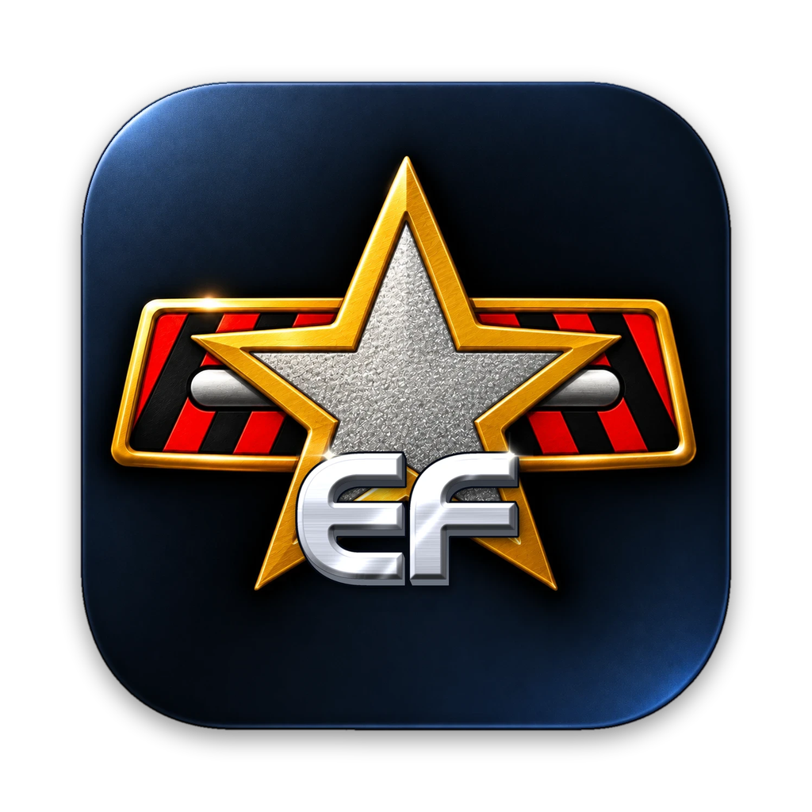
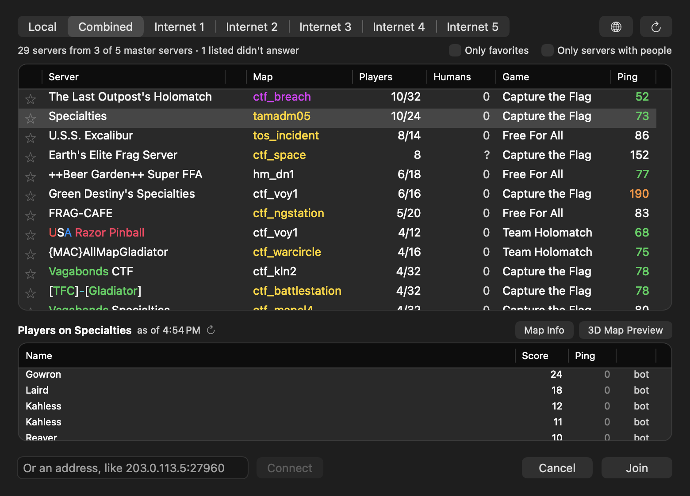

# EliteForce-MacOS-Marino (Marino's Build)


My family didn't let me play M-rated games like Quake growing up, so I played Elite Force as a kid!
With this project, I wanted to create an easily accessible way to play it again, especially in LAN parties.

## What This Is

A native macOS (Apple Silicon) port of *Star Trek: Voyager — Elite Force* (Raven Software,
2000): the **single-player campaign** and **Holomatch** multiplayer, in one app.

A launcher lets you pick **Single Player** or **Holomatch**, set up the graphics and choose
where your game files are, then starts the game. It runs on an ioquake3-based engine with a
Vulkan renderer on Metal (see [Origins](#origins)).

It also supports running a **dedicated multiplayer server**, with automatic port opening
(NAT-PMP / UPnP) and a check that the server is listed on the internet, dramatically
simplifying hosting servers compared to the original game.

New in 1.4.0, both **experimental**:

- **Co-op for the single-player campaign, on the Mac only.** A friend joins your game as a
  second Hazard Team member, on your network or over the internet. See
  [Co-op (experimental, Mac only)](#co-op-experimental-mac-only).
- **Windows and Linux (including Steam Deck) builds** of the same game, with their own
  launchers, but without co-op. See [Windows and Linux (experimental)](#windows-and-linux-experimental).


**No game data is included.** You need your own copy of the retail game. (Even the icon is intentionally not using copyrighted symbols.)

> This is a relatively new release: the campaign is playable and my old PC savegames load, but
> it hasn't been played through end to end on macOS yet. If you see any glitches, please
> [report them](#reporting-issues).

## Screenshots


## Features

- **Launcher.** Choose Single Player or Holomatch; a graphics **Quality** preset
  (Performance, Balanced, Best) or the individual settings: window or full screen, window
  size, full Retina resolution, anti-aliasing, texture detail, V-Sync and **Brightness**; your Holomatch
  player name, internet master servers (**Servers…**) and a server browser (**Browse…**);
  **Host a Server** with its **Config…**; and where the game files are, whether the Expansion Pack was found, and
  **Add Game Files…** to copy in more `.pk3` files. The launcher shows what the game last
  used, including changes made in the game's own Video menu. Quitting from the game's own
  menu brings the launcher back; **Cmd+Q** quits for good (**Cmd+W** and the game window's
  close button ask first, so a stray Cmd+W doesn't end your game). When a newer version is on this
  page's Releases, the launcher says so, with a **Download…** button (checked at most once a
  day; **Check for Updates…** and **Check for Updates Automatically** are in the app menu).
  
  
- **Holomatch (multiplayer).** Join games on your local network (LAN party, see
  [Holomatch and LAN parties](#holomatch-and-lan-parties)), on the internet through the Join
  menu's Internet sources (live community master servers), or by IP address, with bots.
  **Browse…** in the launcher lists every server on your network or on the internet masters,
  with who's playing, the map and ping, favorites and filters, a look at custom maps (even in
  3D) and **Join links** from websites like [efservers.com](https://efservers.com). See
  [Finding a game: Browse…](#finding-a-game-browse).
  It speaks the original Elite Force 1.2 network protocol, with many fixes from
  [cMod](https://github.com/Chomenor/ioef-cmod) by Noah Metzger. It also includes **cMod's game
  modules** by Noah Metzger, with his permission: a **widescreen HUD** and menus, and weapon fire
  prediction on servers that offer it (see [cMod's game modules](#cmods-game-modules)).
  Single player and Holomatch keep separate settings (`efspconfig.cfg` / `hmconfig.cfg`);
  single player never opens a network connection, except when you use co-op.
- **Co-op (experimental, Mac only).** Play the single-player campaign with a friend: the
  launcher's **Co-op…** button hosts a game or joins one, on your network or over the
  internet, with revives instead of instant death. See
  [Co-op (experimental, Mac only)](#co-op-experimental-mac-only).
- **Dedicated server.** **Host a Server** runs a standalone server with a status window
  (players with Kick, console, map and bot controls), **Play on This Mac**, and automatic
  router port opening (NAT-PMP / UPnP). See [Hosting a server](#hosting-a-server).
- **Native Apple Silicon, Vulkan on Metal.** No Rosetta; the single-player game runs as native
  code, and the Quake3e Vulkan renderer runs on Metal through MoltenVK.
- **Retina / High-DPI.** With **High-DPI** on, the game renders at the display's native
  resolution (a 1920×1080 window at 3840×2160), switchable any time from the Video menu.
- **Native macOS fullscreen, switchable live** with the green window button or **Alt+Enter**,
  even mid-mission. The window can be resized, and the Video menu has **Window Size**,
  **Fullscreen** and **High-DPI**.
- **Bink cinematics** (intro, logos, in-game movies) decoded with FFmpeg. Scripted cutscenes
  can be skipped with **Enter**, as in the original.
- **Widescreen.** On wide displays the view is wider at the sides, not cropped at the top and
  bottom (`cg_forceAspect 1` for the original 4:3 view).
- **Original PC saves load.** Savegames from the Windows version can be loaded, with their open
  and closed doors as they were.
- Mac keyboard and mouse: the macOS press-and-hold accent popup is disabled, so holding
  movement keys works, and text input is only active in the console, chat and menus.

## Requirements

- **An Apple Silicon Mac** (M1 or later). Intel Macs are not supported.
- **macOS 12 Monterey or later.**
- **The retail game.** Copy these files from the `BaseEF` folder of a PC installation:
  - `pak0.pk3` (about 541 MB, the main game data). This one is required.
  - `pak1.pk3` and `pak2.pk3`, from the 1.1 and 1.2 patches. Also required, for single
    player too: they carry the patched maps and Holomatch's game code. The original CD has
    only `pak0.pk3`; GOG and Steam copies come patched. Without them the launcher says
    **Patch 1.2 missing**, and **Add Game Files…** adds them.
  - `pak3.pk3` and other extra paks, if you have them.

  GOG and Steam copies work. **GOG's Windows installer** (the offline setup `.exe`)
  works without a PC: choose the `.exe` itself with **Choose…** or **Add Game Files…** and the
  app unpacks its `.pk3` files (pak0–pak3 and playermaps, so the Expansion Pack too), checking
  each against the installer's own checksums. If an installer can't be read, the app says so
  and asks for a `BaseEF` folder from a PC install instead. A full install from the original
  CD works too. A
  **minimum install from the CD does not copy `pak0.pk3` to disk**: it stays on the CD, at
  `BaseEF/pak0.pk3`. Copy it from the CD yourself.

  The **Expansion Pack** is optional. Its files go into the same `BaseEF`: if they're there
  when you choose the folder they're copied along; otherwise use **Add Game Files…** in the
  launcher and choose the Expansion Pack's `BaseEF` (or its `.pk3` files). The launcher's
  Game Files section says whether it was found. It adds single player's Virtual Voyager and
  Holomatch maps that many servers run (such as `ctf_oldwest`).

For Windows and Linux (experimental), see
[Windows and Linux (experimental)](#windows-and-linux-experimental).

## Install (players)

1. Download `EliteForce-MacOS-Marino-<version>.dmg` (or the `.zip`) from the
   [Releases page](https://github.com/marinohardin/EliteForce-MacOS-Marino/releases).
2. Open the DMG and drag **Elite Force.app** onto the Applications shortcut (or unzip the
   `.zip` and move the app to `/Applications`, or anywhere you like). Release builds are
   signed and notarized by Apple, so macOS opens them without warnings.
3. Open the app. The launcher opens. It looks for your game data, and if it can't find it,
   click **Choose…** under **Game Files** and pick **the folder where Elite Force is
   installed** (the folder that contains `BaseEF`), or GOG's setup `.exe`:
   - By default the app **copies** the game files (`*.pk3`) and any saves from that
     `BaseEF` into its own data folder, so you can delete or move the original afterwards.
   - Tick **"Use BaseEF files in place rather than copy"** to read them from where they
     are instead (no copy, nothing extra on disk). The app remembers that folder.
   - If the chosen `BaseEF` has no `pak0.pk3` (a minimum CD install), the app says so;
     copy `pak0.pk3` from the CD and try again. If it has `pak0.pk3` but not the patch's
     `pak1.pk3` and `pak2.pk3` (files from the CD alone), the launcher says **Patch 1.2
     missing** and keeps Play off until you add them with **Add Game Files…**.

   Then pick **Single Player** or **Holomatch**, adjust the graphics if you like, and
   click **Play**.

### Saves and settings

Config files, saves (and game files the app copied) live in
`~/Library/Application Support/EliteForce-MacOS/baseEF/`. You don't need to find that
folder yourself: the app's **File** menu has

- **Return to Launcher…** and **Switch to Holomatch** / **Switch to Single Player**:
  restart the app at the launcher, or straight in the other mode,
- **Show Saves Folder** and **Show Game Folder**: open them in Finder,
- **Change Game Folder…**: pick a different install (the app restarts to use it),
- **Delete Saves & Settings…**: moves the app's data folder to the Trash (it lists what's
  in it first). A game folder you chose to use in place is never touched.

Saves from the Windows version work: the app copies them when it copies your `BaseEF`, or
you can drop `.sav` files into the saves folder.

## Co-op (experimental, Mac only)

Play the single-player campaign with a friend. One Mac **hosts**: it plays the story as usual,
as player 1. The other Mac **joins** as player 2, a second Hazard Team member in the host's
game. Co-op is new and experimental, and only in the Mac app (not on Windows or Linux).

Both players need the same version of the app and the same single-player game files.

### Host and Join

Click **Co-op…** on the launcher's Single Player card. The sheet has:

- **Your name**, shown to the other player in co-op messages (such as "Hold Use to revive …").
  It starts as your Mac's name.
- **Host**: starts single player with co-op on; choose **New Game** or **Load** as usual. An
  optional password keeps strangers out. The sheet lists this Mac's address for your friend.
- **Join**: type the host's address (such as `192.168.1.20`) and click **Check**, which asks
  whether a co-op game runs there and shows what the host is playing. Then click **Connect**.
  Choose whether you play a **male or female Munro** (how player 2 looks on both screens; the
  story still talks to the host's Munro), and type the password if the host set one.

As the guest you see the host's world live from player 2's eyes: enemies, doors, lifts,
explosions, cutscenes and in-game movies, with the host's voice lines, sounds and messages. You
follow the host to the next level, and you see when the host pauses. Enemies fight both of you,
and triggers, pickups and weapons work for either player.

Without a guest, a computer-controlled player 2 follows the host around. Co-op is only on when you
use **Host** or **Join**: the normal **Play** and New Game are plain single player, as before.

### Downed, not dead

A player who runs out of health goes **down** instead of dying. The partner revives them by
standing next to them and **holding Use for 3 seconds** (not through walls, closed doors or
forcefields); they come back with a quarter of their health. If both players are down, or a
downed player bleeds out before being revived (about 30 seconds), it's game over for both.
Hazards such as pits, lava and crushers don't down you: they put you back next to your partner.

### Saves

**Only the host saves.** A save stays a normal single-player save that loads without co-op too;
player 2's health, armor and weapons go in a `.coop` file next to it, so loading it with a guest
brings player 2 back as it was. Player 2 also keeps health and weapons across level changes.

### Playing over the internet

Co-op uses **UDP port 29760**. On your home network nothing else is needed (allow it when macOS
asks whether Elite Force may find devices on your local network). For a friend on the internet:

- The host ticks **Open the port on my router** in the Host section. The app asks your router
  (NAT-PMP / UPnP) to forward the port and shows your public address, or why the router said no.
  If it can't, forward UDP 29760 to the host's Mac by hand, or use a private network like
  [Tailscale](https://tailscale.com).
- **Copy Invite** copies an invite link (`stvef://coop/…`). Your friend opens it and the Co-op
  sheet opens on their Mac with your address filled in and checked.
- Player 2's shots are lag-compensated (they hit what the guest saw), and the guest's own rifle
  and I-MOD fire shows at once instead of after a round trip. Both follow the ideas of cMod's
  lag compensation and weapon fire prediction by **Noah Metzger (Chomenor)**: thank you, Noah.
  Co-op uses about 3 to 5 KB/s.

### Background play

While hosting or joined, the game keeps running when its window isn't in front, so the other
player isn't left waiting. Untick **Keep playing in the background** in the Co-op sheet to turn
this off.

### Known limits

- The game can't be saved while a player is down.
- A player downed behind a barrier that later closes can't be reached, which ends in game over.
- The computer-controlled player 2 (when there's no guest) can't climb ladders or crouch through
  low gaps. It is moved next to you when it gets stuck.
- Only the rifle and I-MOD shots show at once on the guest; other weapons fire after a round trip.
- So far co-op has been tested with two copies of the app on one Mac. It hasn't been tested yet
  between two Macs, on a home network or over the internet.
- Some maps may still have co-op glitches (turbolifts, transporters, scripted sequences). Please
  [report them](#reporting-issues).

## Holomatch and LAN parties

Everyone needs their own copy of the game and the app (or Elite Force 1.2 on a PC; the
protocol is the original one). Holomatch uses `pak0.pk3`–`pak2.pk3` from the retail game, so
copy all of them; extra map paks (`*.pk3` in `BaseEF`) must match between host and players
for the maps they use. Custom maps download automatically when you join a server that has
them (over HTTP when the server offers it). They're kept in a `downloads` folder in the app's
data folder and only override the game's own files on a server that uses them. The official
paks never download, so **Expansion Pack maps need the Expansion Pack** (a server
running one shows "Couldn't load maps/….bsp" otherwise).

1. Everyone opens the app, picks **Holomatch**, sets a **player name** and clicks **Play**.
2. The host opens **Servers → Create Server**, picks a map and game type (and bots, if you
   like) and starts it.
3. The others open **Servers**, set the source to **Local**, pick the host's game and click
   **Engage**, or connect by address from the console (`connect 192.168.1.20`, the
   host's IP address).

Notes:

- The first time, macOS may ask whether Elite Force may **find devices on your local
  network** (and, with the firewall on, **accept incoming connections** on the host): allow
  it, or LAN games won't show up. Both can be changed later in **System Settings → Privacy
  & Security → Local Network** and **Network → Firewall**.
- The game uses **UDP port 27960** (the next players on the same Mac 27961, …). The Join
  menu's LAN search only looks at ports 27960–27963.

### Hosting a server

Instead of hosting from inside the game, pick **Host a Server** in the launcher. **Config…**
sets the map rotation, game type, Holomatch modifiers, limits, bots, name, password, network and
**Tick Rate** (**High** sends players 40 updates a second instead of 20).
**Start Server** runs a standalone server (no game window) in a window of its own, with its
address, the players and its console; **Play on This Mac** joins it from the same Mac. The
launcher stays open, so you can play single player while friends play on your server. Starting
a second server asks first, since players would see both. It also runs from Terminal:
`"/Applications/Elite Force.app/Contents/MacOS/Elite Force" +set dedicated 1 +map hm_voy1`
(`dedicated 2` for the internet), with console commands typed into Terminal.


### cMod's game modules

Holomatch includes **cMod's game modules** (cgame, ui and qagame) by **Noah Metzger
(Chomenor)**, unchanged and with his kind permission (`Contents/Resources/cmod`). They are used
in place of the game's stock ones (patch 1.2's `pak2.pk3`), never in place of a mod's own, and
not on pure servers (there the server's files apply, as before):

- **Widescreen HUD and menus**: the HUD stays sharp and in proportion on a wide screen, at the
  edges or nearer the middle (launcher: Holomatch, **HUD**).
- **Lag compensation** on a server you host (Config…, **cMod** tab): shots hit what the shooter
  saw, so players with a high ping can aim normally. It's done by the server, so it works for
  every player, whatever game they run. Players are never sent cMod's files.
- **Weapon fire prediction** on servers that offer it (cMod servers and yours): your shots show
  at once instead of after a round trip.
- Many bug fixes in the game code.

**Use cMod's game modules** in the launcher (Holomatch) and **Run cMod's game code** (Host a
Server, cMod tab) turn them off; everything then works as before.

### Playing over the internet

Players outside your home network can only reach your server if your router lets their
connection through to your Mac:

- **Automatic (recommended):** in **Config… → Server**, choose **Internet** and leave **Open the
  port on my router automatically** on. While the server runs, the app asks your router
  (NAT-PMP / UPnP, which most home routers support) to forward the port, and the server window
  shows your public address to give friends. The port closes again when the server stops.
  Its **Listed** row names every master that lists your server (proof the port is open) and
  any that don't yet; some masters list new servers late, or only copy another master's list.
  Most routers don't loop their public address back, so your own Mac couldn't reach your server
  through the Internet list. **Loopback Host Fix** (in the launcher, on by default) lists it as
  this Mac instead, so you see it too, marked *(this Mac)* in **Browse…**.
- **If the router refuses** (the feature is off or unsupported, or your provider puts you
  behind a second NAT), the server window says why. Then either forward **UDP 27960** (or your
  chosen port) to your Mac by hand in the router's settings, or use a private network like
  [Tailscale](https://tailscale.com): everyone installs it and joins your tailnet, then connects
  to your Mac's Tailscale address (`connect 100.x.y.z`). The Join menu won't list it there;
  connect by address.

### Internet games and master servers

The Join menu's **Internet 1** to **Internet 5** sources each ask one **master server**, a
community-run list of the Holomatch games on the internet. Raven's original master is long
gone, so the launcher's **Servers…** button (under Holomatch) lets you pick them. The
recommended defaults put the live ones first:

| Join menu | Master server |
|---|---|
| Internet 1 | `master.stef1.daggolin.de` (the most complete list) |
| Internet 2 | `efmaster.tjps.eu` |
| Internet 3 | `master.stvef.org` (copies daggolin's list) |
| Internet 4 | `master.stef1.ravensoft.com` (Raven's, offline; kept in case it returns) |
| Internet 5 | `ipv6.tjps.eu` (IPv6 only) |

The sheet shows which ones answer and how many games each lists. Add a master (up to 16) as
the community starts new ones, drag them into the order you want, or go back with **Restore
Recommended Defaults** or **Restore Original Defaults** (the game's own: Raven's, then tjps). A
server you host for the internet announces itself to every master in the list; only the first
five appear in the Join menu, while **Browse…** has a tab for each, plus **Combined**, which
merges all their lists.

### Finding a game: Browse…

**Browse…** (in the launcher, under Holomatch) lists the servers on your network, on all the
master servers together (**Combined**) or on each one, and joins one directly.



- **Humans** counts only the people, not bots (**?** when a server doesn't say). Servers with
  people come first.
- **cMod** shows which servers run cMod, and its version.
- **Select a server** to see who's playing. Only that server is asked.
- **Map colors:** amber maps download when you join (if the server allows it); purple ones are
  Expansion Pack maps, which servers can't send. **Map Info** and **3D Map Preview** show a
  custom map on efservers.com; the app looks the map up there when you select the server.
- **Join links** (`stvef://…`) on websites like efservers.com open the app and join that
  server. If another app such as cMod opens them, Browse… offers **Open Join Links with Elite
  Force**.

### Uninstall

Choose **File → Delete Saves & Settings…** (this also removes any game files the
app copied), then drag the app to the Trash.

## Windows and Linux (experimental)

There are also **experimental** builds for Windows and Linux, with the same engine, fixes and
cMod game modules as the Mac app: single player and Holomatch. **Co-op is Mac only**: these
builds don't have it (the Co-op button is hidden). They've had little testing on real Windows PCs
and Linux distributions so far, so please [report](#reporting-issues) what you find.

Download them from the [Releases page](https://github.com/marinohardin/EliteForce-MacOS-Marino/releases):

- **Windows 10 or 11, 64-bit:** `EliteForce-Marino-<version>-windows-x64-setup.exe` (an installer
  for your user only, no administrator rights; Start menu entries for Single Player, Holomatch and
  a Dedicated Server, and `stvef://` join links) or `EliteForce-Marino-<version>-windows-x64.zip`
  (unpack anywhere and run `EliteForce.exe`).
- **Linux x86_64 and Steam Deck:** `EliteForce-Marino-<version>-x86_64.AppImage`, a single file
  that runs on most distributions (glibc 2.31 or newer, e.g. Ubuntu 20.04 and later) and on
  SteamOS. Make it executable (`chmod +x`, or "Allow executing as program") and open it.

Both need a GPU and driver with Vulkan 1.1, and your own copy of the game, as on the Mac.

**Launchers.** Windows has a native launcher, Linux a Qt one. Like the Mac launcher, they set up
the game files (a game folder, GOG's setup `.exe` or the CD), and have the graphics presets,
Brightness, the Holomatch server browser, **Host a Server** with router port opening, and update
checks.

**Game files.** Choose them in the launcher, or copy the `.pk3` files from `BaseEF` yourself:

- Windows: `%APPDATA%\EliteForce-Marino\baseEF` (paste it into Explorer's address bar), or a
  `BaseEF` folder next to `EliteForce.exe`.
- Linux: `~/.local/share/eliteforce-marino/baseEF/`. A GOG install under Heroic or Lutris and a
  Steam install are found too.

**Windows SmartScreen.** The Windows build isn't code-signed yet, so the first time you run it
Windows may say "Windows protected your PC". Click **More info**, then **Run anyway**.

**Steam Deck.** Add the AppImage to Steam as a non-Steam game (in Desktop Mode), copy your game
files into the folder above, and play from Gaming Mode. On the first run the game goes fullscreen
and sets up the controller (left stick moves, right stick looks, triggers fire). You can change
the bindings under Controls; the Linux launcher's **Steam Deck Controls…** button puts them back.

The `ReadMe.txt` that comes with each download ([Windows](windows/ReadMe.txt),
[Linux](linux/ReadMe.txt)) has the details, including command-line options.

## Building from source

Everything needed to build is in the repository. Game data is only needed to run.

### Prerequisites

- Xcode Command Line Tools: `xcode-select --install`
- [Homebrew](https://brew.sh) packages:

  ```sh
  brew install cmake ninja pkg-config molten-vk vulkan-headers vulkan-loader
  ```

  (`vulkan-loader` is only used by `run-macos.sh`; the `.app` bundles its own.)
- SDL and the Vulkan loader for the app: `macos/build-deps.sh` builds SDL3 3.4.18,
  sdl2-compat 2.32.74 and the Vulkan loader 1.4.363 (the releases Homebrew ships, checksums
  pinned) for the app's minimum macOS into `build-deps/install`. Homebrew's own builds target
  the build Mac's macOS, so bundling them would raise the app's minimum. `make-app.sh` runs it
  when needed; the engine CMake uses it automatically (else pkg-config's `sdl2`).
- FFmpeg for the cinematics: `macos/build-ffmpeg.sh` downloads FFmpeg 9.0.2 and builds a
  minimal LGPL version (Bink only, for the app's minimum macOS) into `build-ffmpeg/install`. `make-app.sh` runs it when
  needed; the engine CMake uses it automatically, and falls back to a Homebrew `ffmpeg` if
  it hasn't been built.

### Build

The game modules and the engine are two separate CMake projects:

```sh
# 1. Single-player game + UI modules -> efgame/buildmac/libefgame.dylib, libefui.dylib
cmake -S efgame -B efgame/buildmac -DCMAKE_OSX_ARCHITECTURES=arm64
cmake --build efgame/buildmac -j

# 2. Engine executable -> build-macos/efsp  (run macos/build-ffmpeg.sh once first)
cmake -S EFAndroid-SP/app/jni/macos -B build-macos
cmake --build build-macos -j
```

### Run from the build tree

`run-macos.sh` copies the dylibs next to the executable, points SDL at Homebrew's Vulkan
loader, and starts a 1280×720 window:

```sh
./run-macos.sh                                   # data in ./Star Trek Voyager Elite Force/BaseEF
EF_DIR=/path/to/EliteForce ./run-macos.sh        # a folder that contains BaseEF/
EF_DIR=/path/to/EliteForce ./run-macos.sh +set r_fullscreen 1 +set r_highdpi 1
```

`EF_DIR` is the folder that *contains* `BaseEF` (the `fs_basepath`), not `BaseEF` itself.

### Make the .app

```sh
macos/make-app.sh             # builds both parts, then writes and ad-hoc signs "dist/Elite Force.app"
NO_BUILD=1 macos/make-app.sh  # re-bundle only
```

`macos/make-release.sh` builds the app and packages it for a release as a `.dmg` (with an
Applications shortcut) and a `.zip` in `dist/`.

Local builds are ad-hoc signed and run on your own Mac without an Apple developer account.
With a Developer ID certificate, `make-release.sh` also signs, notarizes and staples the
release ([docs/PUBLISHING.md](docs/PUBLISHING.md)).

The script copies `efsp` and the two game modules into `Contents/MacOS`, and SDL3 +
sdl2-compat, the LGPL FFmpeg libraries, the Vulkan loader and MoltenVK into
`Contents/Frameworks` (license texts go in `Contents/Resources/licenses`), rewrites their install names to `@rpath`, and fails if anything still
points outside the bundle or the system. cMod's game modules go in `Contents/Resources/cmod`
from a local copy of the pk3 (pk3s aren't in git): the newest `macos/cmod/pakcmod-release-*.pk3`,
or `CMOD_PAK=<file>`; see `macos/cmod/README.txt`. Without one the app is built without them. `APP_NAME`, `DISPLAY_NAME`, `BUNDLE_ID` and `BREW`
can be overridden.

Build options (engine CMake): `-DEF_BINK=OFF` builds without FFmpeg (no cinematics);
`-DEF_FFMPEG_PREFIX=/path` uses another FFmpeg install (empty: pkg-config's default).
`-DEF_VM_JIT=ON` enables the experimental aarch64 QVM JIT; it is off by default and not
needed: the SP game runs natively, and the interpreter is fast enough for Holomatch.

The engine runs single player by default; `+set com_holomatch 1` starts Holomatch (the
launcher passes it; it is command-line only). From the `.app`, naming the mode on the
command line also skips the launcher:
`"Elite Force.app/Contents/MacOS/Elite Force" +set com_holomatch 1`.

Technical background on the port is in
[docs/macos-port-notes.md](docs/macos-port-notes.md).

## Known issues

- **Expansion Pack content needs the Expansion Pack's data.** Without it, single player's
  Virtual Voyager button shows **EXPANSION ONLY** (greyed out) and Holomatch servers running
  Expansion maps can't be joined. The Expansion Pack itself is untested with this port.
- **Still being tested.** Please report any glitches found. Back up your saves.
- The Mac app is Apple Silicon only.
- **Holomatch is new.** Mac-to-Mac games over LAN and online are tested. The internet
  server browser depends on community master servers being online (see **Servers…**).
- **Co-op is experimental (Mac only).** Host and guest need the same app version and the same
  single-player game files. It has been tested with two copies on one Mac, not yet between two
  Macs or over the internet. See [Known limits](#known-limits) for the rest.
- **Windows and Linux are experimental.** The Windows build is unsigned (SmartScreen warning), and
  both have had little testing on real PCs and Linux distributions.
- Lip sync uses a simpler mouth cycle when the OpenAL sound backend is selected.

## Reporting issues

Please open an issue on GitHub with:

- your Mac model and macOS version,
- where your game data comes from (GOG, Steam, CD + patch) and which `pak*.pk3` files you have,
- what happened and how to reproduce it (map name, save file if relevant),
- the console log. Start from Terminal with
  `"/Applications/Elite Force.app/Contents/MacOS/Elite Force" 2>&1 | tee ef.log`, or use
  `qconsole.log` (enable with `+set logfile 2`). Add `+set developer 1` for verbose logs.

See also [CONTRIBUTING.md](CONTRIBUTING.md).

## Origins

This is a fork of [VoyagerSP-Android](https://github.com/imjustadudegamer/VoyagerSP-Android)
by imjustadudegamer, the Android port of Elite Force single-player. That port was inspired by
[VoyagerNX](https://github.com/faithvoid/VoyagerNX), faithvoid's Nintendo Switch port. It is
built on [lilium-voyager](https://github.com/clover-moe/lilium-voyager) (Zack Middleton),
[ioquake3](https://github.com/ioquake/ioq3) and id Software's Quake III Arena, with the
Vulkan renderer from [Quake3e](https://github.com/ec-/Quake3e) (Eugene C.). Many Holomatch fixes
and improvements come from [cMod](https://github.com/Chomenor/ioef-cmod) by **Noah Metzger
(Chomenor)**, who kindly offered to collaborate: huge thanks for his work. The Android-only
parts (the Java/Gradle app, its SDL and FFmpeg copies) have been removed. The shared engine
code still lives under `EFAndroid-SP/app/jni/` so upstream changes keep merging cleanly. Full attribution:
[CREDITS.md](CREDITS.md).

## License

This repository contains code under **two different licenses**, plus a trademark you should
know about:

- **Engine and port code: GNU GPL version 2 or later** ([LICENSE](LICENSE)). This covers
  everything under `EFAndroid-SP/` (the idTech 3 engine from id Software → ioquake3 →
  lilium-voyager, the Quake3e Vulkan renderer) and the macOS port changes. You may use,
  modify and redistribute it under the GPL, including providing source with any binaries.
- **Single-player game module (`efgame/`): Raven Software's "Limited Use Software License
  Agreement"** (`efgame/STEF Game Source License.doc`). **Not GPL, not open source.** In plain
  words, it allows you to modify the code and distribute it **free of charge, for
  non-commercial purposes only**, with a copy of that license, and **only for use with the
  full retail version of Elite Force**. Selling it or using it commercially in any way is not
  allowed.
- **cMod's game modules** (`Contents/Resources/cmod`, by Noah Metzger, included with his
  permission) are built from Raven's game source too, so the same Raven license applies to them.
- **No game assets are included.** Maps, models, textures, sounds, music and videos belong to
  their owners and come from your own retail copy.
- **Star Trek** and related marks are trademarks of **Paramount** (CBS Studios). *Elite Force*
  was developed by Raven Software and published by Activision. This is an unofficial,
  non-commercial fan project. It is not affiliated with or endorsed by any of them.

Release builds also bundle third-party libraries (SDL and FFmpeg; the Vulkan loader and MoltenVK
on the Mac; libcurl on Windows; Qt for the Linux launcher) under their own licenses. See [THIRD_PARTY_LICENSES.md](THIRD_PARTY_LICENSES.md).

## Personal Note

Thanks for checking this out!  This was a project I learned a lot on. I hope you enjoy playing!
Qapla'!

- Marino
