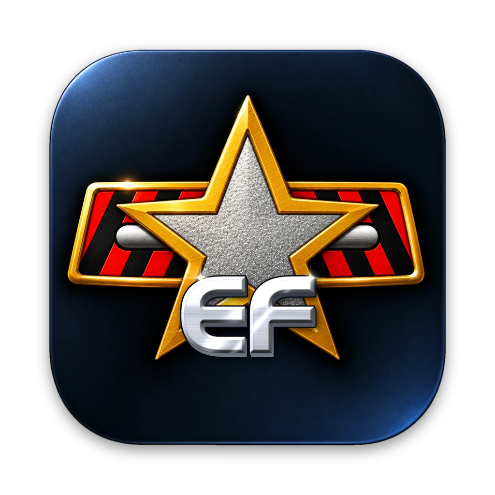

# EliteForce-MacOS-Marino (Marino's Build)


My family didn't let me play M rated games like Quake growing up, so I played Elite Force as a kid! 
With this project, I wanted to create an easily accessible way to play it again, especially in LAN parties.

## What This Is

A native macOS (Apple Silicon) port of *Star Trek: Voyager — Elite Force* (Raven Software,
2000): the **single-player campaign** and **Holomatch** multiplayer, in one app.

A launcher lets you pick **Single Player** or **Holomatch**, set up the graphics and choose
where your game files are, then starts the game. The engine is an idTech 3 derivative
(lilium-voyager, an ioquake3 fork) with the Quake3e Vulkan renderer, which runs on Metal
through MoltenVK. Single-player game logic comes from Raven's officially released Elite
Force SP source, built as native modules; Holomatch runs the retail game's own multiplayer
code from your `pak*.pk3` files, like lilium-voyager does.

It also supports running a **dedicated multiplayer server**, with NAT-PMP support, dramatically simplifying hosting servers compared to the original game.


**No game data is included.** You need your own copy of the retail game. (Even the icon is intentionally not using copyrighted symbols.)

> Status: **beta.** The campaign is playable, my old PC savegames load, but it has not been played 
> through end to end on macOS yet. Please [report issues](#reporting-issues).

## Screenshots


## Features

- **Launcher.** Choose Single Player or Holomatch; a graphics **Quality** preset
  (Performance, Balanced, Best) or the individual settings: window or full screen, window
  size, full Retina resolution, anti-aliasing, texture detail and V-Sync; your Holomatch
  player name; and where the game files are, whether the Expansion Pack was found, and
  **Add Game Files…** to copy in more `.pk3` files. The launcher shows what the game last
  used, including changes made in the game's own Video menu.
  
- **Holomatch (multiplayer).** Host or join games on your local network (LAN party, see
  [Holomatch and LAN parties](#holomatch-and-lan-parties)) or by IP address, with bots.
  It speaks the original Elite Force 1.2 network protocol, unchanged from lilium-voyager.
  Single player and Holomatch keep separate settings (`efspconfig.cfg` / `hmconfig.cfg`);
  single player never opens a network connection.
- **Native arm64.** Built for Apple Silicon, with no Rosetta. The single-player game and UI
  modules are native `.dylib`s, not QVM bytecode.
- **Vulkan via MoltenVK.** The Quake3e `renderervk` renderer, running on Metal.
- **Retina / High-DPI.** With **High-DPI** on, the game renders at the display's native
  resolution (a 1920×1080 window renders at 3840×2160; fullscreen on a 5K panel at 5120×2880).
  The window stays the same size on screen either way, and it can be switched at any time
  from the Video menu, mid-mission too.
- **Native macOS fullscreen, switchable live.** The green window button, **Alt+Enter**,
  Ctrl+Cmd+F or Window → Enter Full Screen all toggle fullscreen at any time, including
  mid-mission; in fullscreen, move the pointer to the top edge for the menu bar. The window
  can also be resized by dragging. The in-game **Video** menu has **Window Size** (sizes that
  fit your screen), **Fullscreen** and **High-DPI**, and settings are remembered between
  launches. The default window is 1920×1080.
- **Bink cinematics** (intro, logos, in-game movies) decoded with FFmpeg.
- **Original PC saves load.** Savegames from the Windows version can be loaded.
- Mac keyboard and mouse: the macOS press-and-hold accent popup is disabled, so holding
  movement keys works, and text input is only active in the console, chat and menus.

## Requirements

- **An Apple Silicon Mac** (M1 or later). Intel Macs are not supported.
- **macOS 12 Monterey or later** (developed and tested on macOS 27 on an M1 Pro; older
  releases are supported by the build but haven't been tried yet).
- **The retail game.** Copy these files from the `BaseEF` folder of a PC installation:
  - `pak0.pk3` (about 541 MB, the main game data). This one is required.
  - The patch paks, such as `pak1.pk3` and `pak2.pk3` (and `pak3.pk3` if you have it).
    Recommended: they carry the 1.1/1.2 patch content.

  GOG and Steam copies work. A full install from the original CD works too. A
  **minimum install from the CD does not copy `pak0.pk3` to disk**: it stays on the CD, at
  `BaseEF/pak0.pk3`. Copy it from the CD yourself.

  The **Expansion Pack** is optional. Its files go into the same `BaseEF`: if they're there
  when you choose the folder they're copied along; otherwise use **Add Game Files…** in the
  launcher and choose the Expansion Pack's `BaseEF` (or its `.pk3` files). The launcher's
  Game Files section says whether it was found. It adds single player's Virtual Voyager and
  Holomatch maps that many servers run (such as `ctf_oldwest`).

## Install (players)

1. Download `EliteForce-MacOS-Marino-<version>.dmg` (or the `.zip`) from the
   [Releases page](https://github.com/marinohardin/EliteForce-MacOS-Marino/releases).
2. Open the DMG and drag **Elite Force.app** onto the Applications shortcut (or unzip the
   `.zip` and move the app to `/Applications`, or anywhere you like). Release builds are
   signed and notarized by Apple, so macOS opens them without warnings.
3. Open the app. The launcher opens. It looks for your game data, and if it can't find it,
   click **Choose…** under **Game Files** and pick **the folder where Elite Force is
   installed** (the folder that contains `BaseEF`):
   - By default the app **copies** the game files (`*.pk3`) and any saves from that
     `BaseEF` into its own data folder, so you can delete or move the original afterwards.
   - Tick **"Use BaseEF files in place rather than copy"** to read them from where they
     are instead (no copy, nothing extra on disk). The app remembers that folder.
   - If the chosen `BaseEF` has no `pak0.pk3` (a minimum CD install), the app says so;
     copy `pak0.pk3` from the CD and try again.

   It also quietly uses a `baseEF` folder placed next to the app, if there is one.
   Then pick **Single Player** or **Holomatch**, adjust the graphics if you like, and
   click **Play**.

### Saves and settings

Config files, saves (and game files the app copied) live in
`~/Library/Application Support/EliteForce-MacOS/baseEF/`. You don't need to find that
folder yourself: the app's **File** menu has

- **Return to Launcher…** and **Switch to Holomatch** / **Switch to Single Player**:
  restart the app at the launcher, or straight in the other mode,
- **Show Saves Folder** and **Show Game Folder**: open them in Finder,
- **Change Game Folder…**: pick a different install (the app restarts to use it),
- **Delete Saves & Settings…**: moves the app's data folder to the Trash (it lists what's
  in it first). A game folder you chose to use in place is never touched.

Saves from the Windows version work: the app copies them when it copies your `BaseEF`, or
you can drop `.sav` files into the saves folder. If you played an earlier build of this
port, its saves (from `~/Library/Application Support/Lilium Voyager/` or
`VoyagerSP-MacOS/`) are carried over
automatically on first launch.

## Holomatch and LAN parties

Everyone needs their own copy of the game and the app (or Elite Force 1.2 on a PC; the
protocol is the original one). Holomatch uses `pak0.pk3`–`pak2.pk3` from the retail game, so
copy all of them; extra map paks (`*.pk3` in `BaseEF`) must match between host and players
for the maps they use. Custom maps download automatically when you join a server that has
them; the official paks never do, so **Expansion Pack maps need the Expansion Pack** (a server
running one shows "Couldn't load maps/….bsp" otherwise).

1. Everyone opens the app, picks **Holomatch**, sets a **player name** and clicks **Play**.
2. The host opens **Servers → Create Server**, picks a map and game type (and bots, if you
   like) and starts it.
3. The others open **Servers**, set the source to **Local**, pick the host's game and click
   **Engage**, or connect by address from the console (`connect 192.168.1.20`, the
   host's IP address).

Notes:

- The first time, macOS may ask whether Elite Force may **find devices on your local
  network** (and, with the firewall on, **accept incoming connections** on the host): allow
  it, or LAN games won't show up. Both can be changed later in **System Settings → Privacy
  & Security → Local Network** and **Network → Firewall**.
- The game uses **UDP port 27960** (the next players on the same Mac 27961, …). The Join
  menu's LAN search only looks at ports 27960–27963.
- Holomatch's game logic runs as bytecode (QVM) in the engine's interpreter. It's fast
  enough on Apple Silicon: a match with four bots costs well under a millisecond per frame.

### Hosting a server

Instead of hosting from inside the game, pick **Host a Server** in the launcher. **Config…**
sets the map rotation, game type, Holomatch modifiers, limits, bots, name, password and network.
**Start Server** runs a standalone server (no game window) and shows its address, the players
and its console; **Play on This Mac** joins it from the same Mac. It also runs from Terminal:
`"/Applications/Elite Force.app/Contents/MacOS/Elite Force" +set dedicated 1 +map hm_voy1`
(`dedicated 2` for the internet), with console commands typed into Terminal.


### Playing over the internet

Players outside your home network can only reach your server if your router lets their
connection through to your Mac:

- **Automatic (recommended):** in **Config… → Server**, choose **Internet** and leave **Open the
  port on my router automatically** on. While the server runs, the app asks your router
  (NAT-PMP / UPnP, which most home routers support) to forward the port, and the server window
  shows your public address to give friends. The port closes again when the server stops.
- **If the router refuses** (the feature is off or unsupported, or your provider puts you
  behind a second NAT), the server window says why. Then either forward **UDP 27960** (or your
  chosen port) to your Mac by hand in the router's settings, or use a private network like
  [Tailscale](https://tailscale.com): everyone installs it and joins your tailnet, then connects
  to your Mac's Tailscale address (`connect 100.x.y.z`). The Join menu won't list it there;
  connect by address.

### Internet games and master servers

The Join menu's **Internet 1** to **Internet 5** sources each ask one **master server**, a
community-run list of the Holomatch games on the internet. Raven's original master is long
gone, so the launcher's **Servers…** button (under Holomatch) lets you pick them. The
recommended defaults put the live ones first:

| Join menu | Master server |
|---|---|
| Internet 1 | `master.stvef.org` |
| Internet 2 | `efmaster.tjps.eu` |
| Internet 3 | `master.stef1.daggolin.de` |
| Internet 4 | `master.stef1.ravensoft.com` (Raven's, offline; kept in case it returns) |
| Internet 5 | `ipv6.tjps.eu` (IPv6 only) |

The sheet shows which ones answer and how many games each lists. Add a master (up to 16) as
the community starts new ones, drag them into the order you want, or go back with **Restore
Recommended Defaults** or **Restore Original Defaults** (the game's own: Raven's, then tjps). A
server you host for the internet announces itself to every master in the list; only the first
five appear in the Join menu. The list is passed to the game at each start, and only
`sv_master1`–`5` are saved in `hmconfig.cfg`, so the config still works in other copies of the
game.

### Uninstall

Choose **File → Delete Saves & Settings…** (this also removes any game files the
app copied), then drag the app to the Trash.

## Building from source

Everything needed to build is in the repository. Game data is only needed to run.

### Prerequisites

- Xcode Command Line Tools: `xcode-select --install`
- [Homebrew](https://brew.sh) packages:

  ```sh
  brew install cmake ninja pkg-config molten-vk vulkan-headers vulkan-loader
  ```

  (`vulkan-loader` is only used by `run-macos.sh`; the `.app` bundles its own.)
- SDL and the Vulkan loader for the app: `macos/build-deps.sh` builds SDL3 3.4.18,
  sdl2-compat 2.32.74 and the Vulkan loader 1.4.363 (the releases Homebrew ships, checksums
  pinned) for the app's minimum macOS into `build-deps/install`. Homebrew's own builds target
  the build Mac's macOS, so bundling them would raise the app's minimum. `make-app.sh` runs it
  when needed; the engine CMake uses it automatically (else pkg-config's `sdl2`).
- FFmpeg for the cinematics: `macos/build-ffmpeg.sh` downloads FFmpeg 9.0.2 and builds a
  minimal LGPL version (Bink only, for the app's minimum macOS) into `build-ffmpeg/install`. `make-app.sh` runs it when
  needed; the engine CMake uses it automatically, and falls back to a Homebrew `ffmpeg` if
  it hasn't been built.

### Build

The game modules and the engine are two separate CMake projects:

```sh
# 1. Single-player game + UI modules -> efgame/buildmac/libefgame.dylib, libefui.dylib
cmake -S efgame -B efgame/buildmac -DCMAKE_OSX_ARCHITECTURES=arm64
cmake --build efgame/buildmac -j

# 2. Engine executable -> build-macos/efsp  (run macos/build-ffmpeg.sh once first)
cmake -S EFAndroid-SP/app/jni/macos -B build-macos
cmake --build build-macos -j
```

### Run from the build tree

`run-macos.sh` copies the dylibs next to the executable, points SDL at Homebrew's Vulkan
loader, and starts a 1280×720 window:

```sh
./run-macos.sh                                   # data in ./Star Trek Voyager Elite Force/BaseEF
EF_DIR=/path/to/EliteForce ./run-macos.sh        # a folder that contains BaseEF/
EF_DIR=/path/to/EliteForce ./run-macos.sh +set r_fullscreen 1 +set r_highdpi 1
```

`EF_DIR` is the folder that *contains* `BaseEF` (the `fs_basepath`), not `BaseEF` itself.

### Make the .app

```sh
macos/make-app.sh             # builds both parts, then writes and ad-hoc signs "dist/Elite Force.app"
NO_BUILD=1 macos/make-app.sh  # re-bundle only
```

`macos/make-release.sh` builds the app and packages it for a release as a `.dmg` (with an
Applications shortcut) and a `.zip` in `dist/`.

The script copies `efsp` and the two game modules into `Contents/MacOS`, and SDL3 +
sdl2-compat, the LGPL FFmpeg libraries, the Vulkan loader and MoltenVK into
`Contents/Frameworks` (license texts go in `Contents/Resources/licenses`), rewrites their install names to `@rpath`, and fails if anything still
points outside the bundle or the system. `APP_NAME`, `DISPLAY_NAME`, `BUNDLE_ID` and `BREW`
can be overridden.

Build options (engine CMake): `-DEF_BINK=OFF` builds without FFmpeg (no cinematics);
`-DEF_FFMPEG_PREFIX=/path` uses another FFmpeg install (empty: pkg-config's default).
`-DEF_VM_JIT=ON` enables the experimental aarch64 QVM JIT; it is off by default and not
needed: the SP game runs natively, and the interpreter is fast enough for Holomatch.

The engine runs single player by default; `+set com_holomatch 1` starts Holomatch (the
launcher passes it; it is command-line only). From the `.app`, naming the mode on the
command line also skips the launcher:
`"Elite Force.app/Contents/MacOS/Elite Force" +set com_holomatch 1`.

Technical background on the port is in
[docs/macos-port-notes.md](docs/macos-port-notes.md).

## Known issues

- **Expansion Pack content needs the Expansion Pack's data.** Without it, single player's
  Virtual Voyager button shows **EXPANSION ONLY** (greyed out) and Holomatch servers running
  Expansion maps can't be joined. The Expansion Pack itself is untested with this port.
- **Alpha quality.** Expect occasional rendering, audio or animation glitches inherited from
  the Android port. Back up your saves.
- Apple Silicon only.
- **Holomatch is new.** Mac-to-Mac LAN games are tested; games with PC players (Elite Force
  1.2 or lilium-voyager) use the same protocol but haven't been tried yet. The internet
  server browser depends on community master servers being online (see **Servers…**).

## Reporting issues

Please open an issue on GitHub with:

- your Mac model and macOS version,
- where your game data comes from (GOG, Steam, CD + patch) and which `pak*.pk3` files you have,
- what happened and how to reproduce it (map name, save file if relevant),
- the console log. Start from Terminal with
  `"/Applications/Elite Force.app/Contents/MacOS/Elite Force" 2>&1 | tee ef.log`, or use
  `qconsole.log` (enable with `+set logfile 2`). Add `+set developer 1` for verbose logs.

See also [CONTRIBUTING.md](CONTRIBUTING.md).

## Origins

This is a fork of [VoyagerSP-Android](https://github.com/imjustadudegamer/VoyagerSP-Android)
by imjustadudegamer, the Android port of Elite Force single-player. That port was inspired by
[VoyagerNX](https://github.com/faithvoid/VoyagerNX), faithvoid's Nintendo Switch port. It is
built on [lilium-voyager](https://github.com/clover-moe/lilium-voyager) (Zack Middleton),
[ioquake3](https://github.com/ioquake/ioq3) and id Software's Quake III Arena, with the
Vulkan renderer from [Quake3e](https://github.com/ec-/Quake3e) (Eugene C.). The Android-only
parts (the Java/Gradle app, its SDL and FFmpeg copies) have been removed. The shared engine
code still lives under `EFAndroid-SP/app/jni/` so upstream changes keep merging cleanly. Full attribution:
[CREDITS.md](CREDITS.md).

## License

This repository contains code under **two different licenses**, plus a trademark you should
know about:

- **Engine and port code: GNU GPL version 2 or later** ([LICENSE](LICENSE)). This covers
  everything under `EFAndroid-SP/` (the idTech 3 engine from id Software → ioquake3 →
  lilium-voyager, the Quake3e Vulkan renderer) and the macOS port changes. You may use,
  modify and redistribute it under the GPL, including providing source with any binaries.
- **Single-player game module (`efgame/`): Raven Software's "Limited Use Software License
  Agreement"** (`efgame/STEF Game Source License.doc`). **Not GPL, not open source.** In plain
  words, it allows you to modify the code and distribute it **free of charge, for
  non-commercial purposes only**, with a copy of that license, and **only for use with the
  full retail version of Elite Force**. Selling it or using it commercially in any way is not
  allowed.
- **No game assets are included.** Maps, models, textures, sounds, music and videos belong to
  their owners and come from your own retail copy.
- **Star Trek** and related marks are trademarks of **Paramount** (CBS Studios). *Elite Force*
  was developed by Raven Software and published by Activision. This is an unofficial,
  non-commercial fan project. It is not affiliated with or endorsed by any of them.

Release builds also bundle third-party libraries (SDL, FFmpeg, the Vulkan loader, MoltenVK)
under their own licenses. See [THIRD_PARTY_LICENSES.md](THIRD_PARTY_LICENSES.md).

## Personal Note

Thanks for checking this out!  This was a project I learned a lot on. I hope you enjoy playing!
Qapla'!

- Marino
