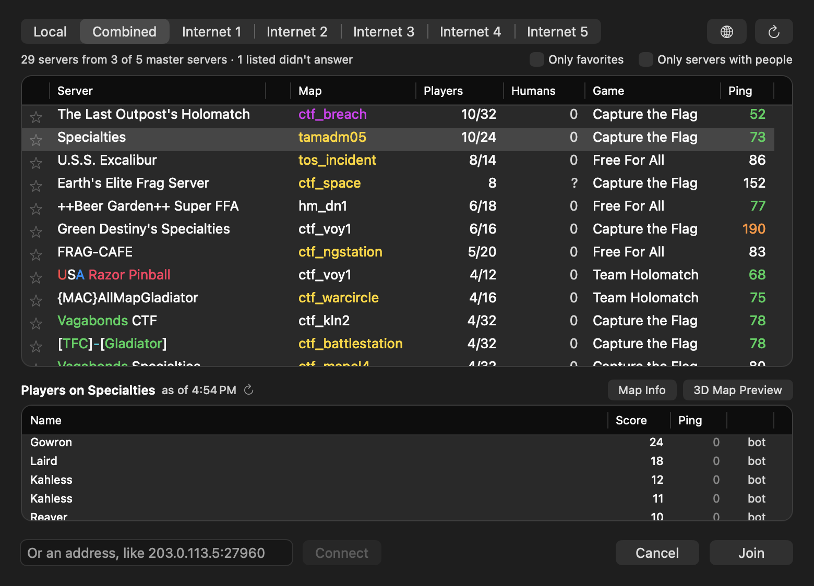

# AwayTeamEF player's guide

The details behind the [README](../README.md): game files, co-op, Holomatch, hosting, and the
Windows and Linux builds. New here? Start with the README's [Get started](../README.md#get-started).

**Contents:** [Game files](#requirements) · [Install on the Mac](#install-on-the-mac) ·
[Co-op](#co-op) · [Holomatch and LAN parties](#holomatch-and-lan-parties) ·
[Windows and Linux](#windows-and-linux) · [Launcher features](#launcher-and-game-features)

## Requirements

- **An Apple Silicon Mac** (M1 or later). Intel Macs are not supported.
- **macOS 12 Monterey or later.**
- **The retail game.** Copy these files from the `BaseEF` folder of a PC installation:
  - `pak0.pk3` (about 541 MB, the main game data). This one is required.
  - `pak1.pk3` and `pak2.pk3`, from the 1.1 and 1.2 patches. Also required, for single
    player too: they carry the patched maps and Holomatch's game code. The original CD has
    only `pak0.pk3`; GOG and Steam copies come patched. Without them the launcher says
    **Patch 1.2 missing**, and **Add Game Files…** adds them.
  - `pak3.pk3` and other extra paks, if you have them.

  GOG and Steam copies work. **GOG's Windows installer** (the offline setup `.exe`)
  works without a PC: choose the `.exe` itself with **Choose…** or **Add Game Files…** and the
  app unpacks its `.pk3` files (pak0–pak3 and playermaps, so the Expansion Pack too), checking
  each against the installer's own checksums. If an installer can't be read, the app says so
  and asks for a `BaseEF` folder from a PC install instead. A full install from the original
  CD works too. A
  **minimum install from the CD does not copy `pak0.pk3` to disk**: it stays on the CD, at
  `BaseEF/pak0.pk3`. Copy it from the CD yourself.

  The **Expansion Pack** is optional. Its files go into the same `BaseEF`: if they're there
  when you choose the folder they're copied along; otherwise use **Add Game Files…** in the
  launcher and choose the Expansion Pack's `BaseEF` (or its `.pk3` files). The launcher's
  Game Files section says whether it was found. It adds single player's Virtual Voyager and
  Holomatch maps that many servers run (such as `ctf_oldwest`).

For Windows and Linux, see
[Windows and Linux](#windows-and-linux).

## Install on the Mac

1. Download `EliteForce-MacOS-Marino-<version>.dmg` (or the `.zip`) from the
   [Releases page](https://github.com/marinohardin/AwayTeamEF/releases).
2. Open the DMG and drag **Elite Force.app** onto the Applications shortcut (or unzip the
   `.zip` and move the app to `/Applications`, or anywhere you like). Release builds are
   signed and notarized by Apple, so macOS opens them without warnings.
3. Open the app. The launcher opens. It looks for your game data, and if it can't find it,
   click **Choose…** under **Game Files** and pick **the folder where Elite Force is
   installed** (the folder that contains `BaseEF`), or GOG's setup `.exe`:
   - By default the app **copies** the game files (`*.pk3`) and any saves from that
     `BaseEF` into its own data folder, so you can delete or move the original afterwards.
   - Tick **"Use BaseEF files in place rather than copy"** to read them from where they
     are instead (no copy, nothing extra on disk). The app remembers that folder.
   - If the chosen `BaseEF` has no `pak0.pk3` (a minimum CD install), the app says so;
     copy `pak0.pk3` from the CD and try again. If it has `pak0.pk3` but not the patch's
     `pak1.pk3` and `pak2.pk3` (files from the CD alone), the launcher says **Patch 1.2
     missing** and keeps Play off until you add them with **Add Game Files…**.

   Then pick **Single Player** or **Holomatch**, adjust the graphics if you like, and
   click **Play**.

### Saves and settings

Config files, saves (and game files the app copied) live in
`~/Library/Application Support/EliteForce-MacOS/baseEF/`. You don't need to find that
folder yourself: the app's **File** menu has

- **Return to Launcher…** and **Switch to Holomatch** / **Switch to Single Player**:
  restart the app at the launcher, or straight in the other mode,
- **Show Saves Folder** and **Show Game Folder**: open them in Finder,
- **Change Game Folder…**: pick a different install (the app restarts to use it),
- **Delete Saves & Settings…**: moves the app's data folder to the Trash (it lists what's
  in it first). A game folder you chose to use in place is never touched.

Saves from the Windows version work: the app copies them when it copies your `BaseEF`, or
you can drop `.sav` files into the saves folder.

After a death, pressing Attack goes back to the save you loaded last, or to the newest autosave
if one was made after that load (the original game always went back to the autosave, which could
be on another map).

## Co-op

Play the single-player campaign with a friend. One computer **hosts**: it plays the story as
usual, as player 1. The other **joins** as player 2, a second Hazard Team member in the host's
game. It is in the Mac app and, since 1.5.0, in the Windows and Linux builds too, with the same
Co-op sheet (the steps below say "Mac"; on Windows it's your PC).
A Mac, a Windows PC and a Linux computer use the same co-op protocol, so they should be able to
play together as long as they run the same version.

Both players need the same version of the app and the game's own `pak0.pk3`, `pak1.pk3` and
`pak2.pk3`. Other packs (Holomatch maps, mods, community packs) don't matter. If only one of you
has the Expansion Pack (`pak3.pk3`), Check shows a warning and you can still join with
**Join Anyway**: the host runs the game, so the difference is mostly cosmetic for player 2.

### Host and Join

Click **Co-op…** on the launcher's Single Player card. The sheet has:

- **Your name**, shown to the other player in co-op messages (such as "Hold Use to revive …").
  It starts as your Mac's name.
- **Host**: starts single player with co-op on; choose **New Game** or **Load** as usual. An
  optional password keeps strangers out. The sheet lists this Mac's address for your friend.
  **Show this game on my network** (on by default) lets friends on the same network find the game
  without typing anything; untick it and only someone who types your address finds it.
  **Team attack** decides whether the two players can hurt each other: **Off** (the default; your
  shots and grenades don't hurt each other, as before), **Half** (half the damage) or **On** (full
  damage). With Half or On, a hit that knocks enemies back knocks the other player back too.
  Explosions follow single player's rules: your own grenade's blast counts as your attack (so the
  setting applies to your partner), while a barrel or other explosive you set off hurts both of you
  as it always has.
- **Join**: **Games on your network** lists the co-op games hosted on your network (it looks
  three times in the first 10 seconds; click **Refresh** to look again): who hosts, the level, a
  lock when the host set a password, and greyed with the reason when you can't join (another app
  version, different game files, or a friend already plays player 2). Click a game to check it,
  or type the host's address (such as `192.168.1.20`) and click **Check**, which asks whether a
  co-op game runs there and shows what the host is playing. Then click **Connect**.
  Choose whether you play a **male or female Munro** (how player 2 looks and sounds on both
  screens; the story still talks to the host's Munro), and optionally a **Character**: a member of
  Voyager's crew or the Hazard Team to look like instead (from the game's own files, so the host has
  them too; the voice stays the Munro you chose). The **Experimental** group has 24
  Holomatch player models (Gowron, Kahless, Sela, the Borg Queen, Captain Proton and more): they
  have only Holomatch's few animations, so player 2 plays the nearest one for each single-player
  move (no pain, ladder or crawl animations of its own). Type the
  password if the host set one.

  

As the guest you see the host's world live from player 2's eyes: enemies, doors, lifts,
explosions, cutscenes and in-game movies, with the host's voice lines, sounds and messages. You
follow the host to the next level, and you see when the host pauses. Enemies fight both of you,
and triggers, pickups and weapons work for either player.

Without a guest, a computer-controlled player 2 follows the host around. Co-op is only on when you
use **Host** or **Join**: the normal **Play** and New Game are plain single player, as before.

### Communicate with Pings

Double tapping the "Use" button will Ping a location on both player's screens in Co-Op.

### Downed, not dead

A player who runs out of health goes **down** instead of dying. The partner revives them by
standing next to them and **holding Use for 3 seconds** (not through walls, closed doors or
forcefields); they come back with a quarter of their health. If both players are down, or a
downed player bleeds out before being revived (about 30 seconds), it's game over for both.
Hazards such as pits, lava and crushers don't down you: they put you back next to your partner.

### Saves

**Only the host saves.** A save stays a normal single-player save that loads without co-op too;
player 2's health, armor and weapons go in a `.coop` file next to it, so loading it with a guest
brings player 2 back as it was. Player 2 also keeps health and weapons across level changes.
After a game over, pressing Attack goes back to the save the host loaded last, or to the newest
autosave if one was made after that load (the same as in single player).

### Playing over the internet

Co-op uses **UDP port 29760**. On your home network nothing else is needed (allow it when macOS
asks whether Elite Force may find devices on your local network). For a friend on the internet:

- **Open the port on my router** in the Host section is on by default (untick it for your own
  network only; it stays unticked). The app asks your router (NAT-PMP / UPnP) to forward the port
  and shows your public address, or why the router said no.
  If it can't, forward UDP 29760 to the host's Mac by hand, or use a private network like
  [Tailscale](https://tailscale.com).
- **Copy Invite** copies an invite link (`stvef://coop/…`). Your friend opens it and the Co-op
  sheet opens on their Mac with your address filled in and checked.
- Player 2's shots are lag-compensated (they hit what the guest saw), and the guest's own rifle
  and I-MOD fire shows at once instead of after a round trip. Both follow the ideas of cMod's
  lag compensation and weapon fire prediction by **Noah Metzger (Chomenor)**: thank you, Noah.
  Co-op uses about 3 to 5 KB/s.

### Background play

While hosting or joined, the game keeps running when its window isn't in front, so the other
player isn't left waiting. Untick **Keep playing in the background** in the Co-op sheet to turn
this off.

### Known limits

- A player downed behind a barrier that later closes can't be reached, which ends in game over.
- The computer-controlled player 2 (when there's no guest) can't climb ladders or crouch through
  low gaps. It is moved next to you when it gets stuck.
- Only the rifle and I-MOD shots show at once on the guest; other weapons fire after a round trip.
- So far co-op has been tested with two copies of the app on one Mac. It hasn't been tested yet
  between two Macs, on a home network or over the internet, nor on real Windows PCs or Linux
  computers, nor between a Mac and a PC.
- Some maps may still have co-op glitches (turbolifts, transporters, scripted sequences). Please
  [report them](../README.md#reporting-issues).

## Holomatch and LAN parties

Everyone needs their own copy of the game and the app (or Elite Force 1.2 on a PC; the
protocol is the original one). Holomatch uses `pak0.pk3`–`pak2.pk3` from the retail game, so
copy all of them; extra map paks (`*.pk3` in `BaseEF`) must match between host and players
for the maps they use. Custom maps download automatically when you join a server that has
them (over HTTP when the server offers it). They're kept in a `downloads` folder in the app's
data folder and only override the game's own files on a server that uses them. The official
paks never download, so **Expansion Pack maps need the Expansion Pack** (a server
running one shows "Couldn't load maps/….bsp" otherwise).

1. Everyone opens the app, picks **Holomatch**, sets a **player name** and clicks **Play**.
2. The host opens **Servers → Create Server**, picks a map and game type (and bots, if you
   like) and starts it.
3. The others open **Servers**, set the source to **Local**, pick the host's game and click
   **Engage**, or connect by address from the console (`connect 192.168.1.20`, the
   host's IP address).

Notes:

- The first time, macOS may ask whether Elite Force may **find devices on your local
  network** (and, with the firewall on, **accept incoming connections** on the host): allow
  it, or LAN games won't show up. Both can be changed later in **System Settings → Privacy
  & Security → Local Network** and **Network → Firewall**.
- The game uses **UDP port 27960** (the next players on the same Mac 27961, …). The Join
  menu's LAN search only looks at ports 27960–27963.

### Hosting a server

Instead of hosting from inside the game, pick **Host a Server** in the launcher. **Config…**
sets the map rotation, game type, Holomatch modifiers, limits, bots, name, password, network and
**Tick Rate** (**High** sends players 40 updates a second instead of 20).
**Start Server** runs a standalone server (no game window) in a window of its own, with its
address, the players and its console; **Play on This Mac** joins it from the same Mac. The
launcher stays open, so you can play single player while friends play on your server. Starting
a second server asks first, since players would see both. It also runs from Terminal:
`"/Applications/Elite Force.app/Contents/MacOS/Elite Force" +set dedicated 1 +map hm_voy1`
(`dedicated 2` for the internet), with console commands typed into Terminal.

### cMod's game modules

Holomatch includes **cMod's game modules** (cgame, ui and qagame) by **Noah Metzger
(Chomenor)**, unchanged and with his kind permission (`Contents/Resources/cmod`). They are used
in place of the game's stock ones (patch 1.2's `pak2.pk3`), never in place of a mod's own, and
not on pure servers (there the server's files apply, as before):

- **Widescreen HUD and menus**: the HUD stays sharp and in proportion on a wide screen, at the
  edges or nearer the middle (launcher: Holomatch, **HUD**).
- **Lag compensation** on a server you host (Config…, **cMod** tab): shots hit what the shooter
  saw, so players with a high ping can aim normally. It's done by the server, so it works for
  every player, whatever game they run. Players are never sent cMod's files.
- **Weapon fire prediction** on servers that offer it (cMod servers and yours): your shots show
  at once instead of after a round trip.
- Many bug fixes in the game code.

**Use cMod's game modules** in the launcher (Holomatch) and **Run cMod's game code** (Host a
Server, cMod tab) turn them off; everything then works as before.

### Playing over the internet

Players outside your home network can only reach your server if your router lets their
connection through to your Mac:

- **Automatic (recommended):** in **Config… → Server**, choose **Internet** and leave **Open the
  port on my router automatically** on. While the server runs, the app asks your router
  (NAT-PMP / UPnP, which most home routers support) to forward the port, and the server window
  shows your public address to give friends. The port closes again when the server stops.
  Its **Listed** row names every master that lists your server (proof the port is open) and
  any that don't yet; some masters list new servers late, or only copy another master's list.
  Most routers don't loop their public address back, so your own Mac couldn't reach your server
  through the Internet list. **Loopback Host Fix** (in the launcher, on by default) lists it as
  this Mac instead, so you see it too, marked *(this Mac)* in **Browse…**.
- **If the router refuses** (the feature is off or unsupported, or your provider puts you
  behind a second NAT), the server window says why. Then either forward **UDP 27960** (or your
  chosen port) to your Mac by hand in the router's settings, or use a private network like
  [Tailscale](https://tailscale.com): everyone installs it and joins your tailnet, then connects
  to your Mac's Tailscale address (`connect 100.x.y.z`). The Join menu won't list it there;
  connect by address.

### Internet games and master servers

The Join menu's **Internet 1** to **Internet 5** sources each ask one **master server**, a
community-run list of the Holomatch games on the internet. Raven's original master is long
gone, so the launcher's **Servers…** button (under Holomatch) lets you pick them. The
recommended defaults put the live ones first:

| Join menu | Master server |
|---|---|
| Internet 1 | `master.stef1.daggolin.de` (the most complete list) |
| Internet 2 | `efmaster.tjps.eu` |
| Internet 3 | `master.stvef.org` (copies daggolin's list) |
| Internet 4 | `master.stef1.ravensoft.com` (Raven's, offline; kept in case it returns) |
| Internet 5 | `ipv6.tjps.eu` (IPv6 only) |

The sheet shows which ones answer and how many games each lists. Add a master (up to 16) as
the community starts new ones, drag them into the order you want, or go back with **Restore
Recommended Defaults** or **Restore Original Defaults** (the game's own: Raven's, then tjps). A
server you host for the internet announces itself to every master in the list; only the first
five appear in the Join menu, while **Browse…** has a tab for each, plus **Combined**, which
merges all their lists.

### Finding a game: Browse…

**Browse…** (in the launcher, under Holomatch) lists the servers on your network, on all the
master servers together (**Combined**) or on each one, and joins one directly.

- **Humans** counts only the people, not bots (**?** when a server doesn't say). Servers with
  people come first.
- **cMod** shows which servers run cMod, and its version.
- **Select a server** to see who's playing. Only that server is asked.
- **Map colors:** amber maps download when you join (if the server allows it); purple ones are
  Expansion Pack maps, which servers can't send. **Map Info** and **3D Map Preview** show a
  custom map on efservers.com; the app looks the map up there when you select the server.
- **Join links** (`stvef://…`) on websites like efservers.com open the app and join that
  server. If another app such as cMod opens them, Browse… offers **Open Join Links with Elite
  Force**.

### Uninstall

Choose **File → Delete Saves & Settings…** (this also removes any game files the
app copied), then drag the app to the Trash.

## Windows and Linux

The Windows and Linux builds have the same engine, fixes and cMod game modules as the Mac app:
single player, Holomatch and co-op (the same **Co-op…** button and sheet; see [Co-op](#co-op)).
The Mac app is the most tested; please [report](../README.md#reporting-issues) what you find on a
PC or Linux. Allow Elite Force through the Windows firewall (or open UDP 29760 on Linux) when you
host a co-op game. On Linux, a firewall that is on (ufw, firewalld) may also drop the answers to the
guest's **Games on your network** search; typing the host's address and clicking **Check** still works.

Download them from the [Releases page](https://github.com/marinohardin/AwayTeamEF/releases)
(each version is one release with the Mac, Windows and Linux files):

- **Windows 10 or 11, 64-bit:** `EliteForce-Marino-<version>-setup.exe` (an installer
  for your user only, no administrator rights; Start menu entries for Single Player, Holomatch and
  a Dedicated Server, and `stvef://` join links) or `EliteForce-Marino-<version>-windows-x64.zip`
  (unpack anywhere and run `EliteForce.exe`).
- **Linux x86_64 and Steam Deck:** `EliteForce-Marino-<version>-x86_64.AppImage`, a single file
  that runs on most distributions (glibc 2.31 or newer, e.g. Ubuntu 20.04 and later) and on
  SteamOS. Make it executable (`chmod +x`, or "Allow executing as program") and open it.

Both need a GPU and driver with Vulkan 1.1, and your own copy of the game, as on the Mac.

**Launchers.** Windows has a native launcher, Linux a Qt one. Like the Mac launcher, they set up
the game files (a game folder, GOG's setup `.exe` or the CD), and have the graphics presets,
Brightness, the Holomatch server browser, **Host a Server** with router port opening, and update
checks.

**Game files.** Choose them in the launcher, or copy the `.pk3` files from `BaseEF` yourself:

- Windows: `%APPDATA%\EliteForce-Marino\baseEF` (paste it into Explorer's address bar), or a
  `BaseEF` folder next to `EliteForce.exe`.
- Linux: `~/.local/share/eliteforce-marino/baseEF/`. A GOG install under Heroic or Lutris and a
  Steam install are found too.

**Windows SmartScreen.** The Windows build isn't code-signed yet, so the first time you run it
Windows may say "Windows protected your PC". Click **More info**, then **Run anyway**.

**Steam Deck.** Add the AppImage to Steam as a non-Steam game (in Desktop Mode), copy your game
files into the folder above, and play from Gaming Mode. On the first run the game goes fullscreen
and sets up the controller (left stick moves, right stick looks, triggers fire). You can change
the bindings under Controls; the Linux launcher's **Steam Deck Controls…** button puts them back.

The `ReadMe.txt` that comes with each download ([Windows](windows/ReadMe.txt),
[Linux](linux/ReadMe.txt)) has the details, including command-line options.

## Launcher and game features

- **Launcher.** Choose Single Player or Holomatch; a graphics **Quality** preset
  (Performance, Balanced, Best) or the individual settings: window or full screen, window
  size, full Retina resolution, anti-aliasing, texture detail, V-Sync and **Brightness**; your Holomatch
  player name, internet master servers (**Servers…**) and a server browser (**Browse…**);
  **Host a Server** with its **Config…**; and where the game files are, whether the Expansion Pack was found, and
  **Add Game Files…** to copy in more `.pk3` files. The launcher shows what the game last
  used, including changes made in the game's own Video menu. Quitting from the game's own
  menu brings the launcher back; **Cmd+Q** quits for good (**Cmd+W** and the game window's
  close button ask first, so a stray Cmd+W doesn't end your game). When a newer version is on this
  page's Releases, the launcher says so, with a **Download…** button (checked at most once a
  day; **Check for Updates…** and **Check for Updates Automatically** are in the app menu).
  
  
- **Holomatch (multiplayer).** Join games on your local network (LAN party, see
  [Holomatch and LAN parties](#holomatch-and-lan-parties)), on the internet through the Join
  menu's Internet sources (live community master servers), or by IP address, with bots.
  **Browse…** in the launcher lists every server on your network or on the internet masters,
  with who's playing, the map and ping, favorites and filters, a look at custom maps (even in
  3D) and **Join links** from websites like [efservers.com](https://efservers.com). See
  [Finding a game: Browse…](#finding-a-game-browse).
  It speaks the original Elite Force 1.2 network protocol, with many fixes from
  [cMod](https://github.com/Chomenor/ioef-cmod) by Noah Metzger. It also includes **cMod's game
  modules** by Noah Metzger, with his permission: a **widescreen HUD** and menus, and weapon fire
  prediction on servers that offer it (see [cMod's game modules](#cmods-game-modules)).
  Single player and Holomatch keep separate settings (`efspconfig.cfg` / `hmconfig.cfg`);
  single player never opens a network connection, except when you use co-op.
- **Co-op.** Play the single-player campaign with a friend: the
  launcher's **Co-op…** button hosts a game or joins one, on your network or over the
  internet, with revives instead of instant death. See
  [Co-op](#co-op).
- **Dedicated server.** **Host a Server** runs a standalone server with a status window
  (players with Kick, console, map and bot controls), **Play on This Mac**, and automatic
  router port opening (NAT-PMP / UPnP). See [Hosting a server](#hosting-a-server).
- **Native Apple Silicon, Vulkan on Metal.** No Rosetta; the single-player game runs as native
  code, and the Quake3e Vulkan renderer runs on Metal through MoltenVK.
- **Retina / High-DPI.** With **High-DPI** on, the game renders at the display's native
  resolution (a 1920×1080 window at 3840×2160), switchable any time from the Video menu.
- **Native macOS fullscreen, switchable live** with the green window button or **Alt+Enter**,
  even mid-mission. The window can be resized, and the Video menu has **Window Size**,
  **Fullscreen** and **High-DPI**.
- **Bink cinematics** (intro, logos, in-game movies) decoded with FFmpeg. Scripted cutscenes
  can be skipped with **Enter**, as in the original.
- **Widescreen.** On wide displays the view is wider at the sides, not cropped at the top and
  bottom (`cg_forceAspect 1` for the original 4:3 view).
- **Original PC saves load.** Savegames from the Windows version can be loaded, with their open
  and closed doors as they were.
- Mac keyboard and mouse: the macOS press-and-hold accent popup is disabled, so holding
  movement keys works, and text input is only active in the console, chat and menus.

